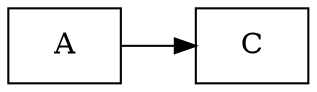
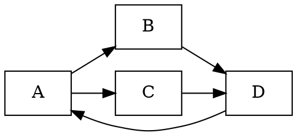

# Визуализатор зависимостей пакетов Cargo

Реализованы этапы 1–5: XML-конфигурация, чтение зависимостей Rust (Cargo), построение
транзитивного графа рекурсивным BFS, исключение пакетов по подстроке, тестовый репозиторий
и порядок загрузки зависимостей с обнаружением циклов, вывод Graphviz DOT.
Используется только стандартная библиотека Go. Менеджеры пакетов и сторонние библиотеки
для получения зависимостей не используются; архивы пакетов не скачиваются.

Для запуска нужен Go 1.26.1 и POSIX-совместимая оболочка.
Все команды выполняются через `run.sh` в корне проекта:

```sh
./run.sh
./run.sh run -config config.xml
./run.sh run -config examples/test.xml
./run.sh run -config examples/order.xml
./run.sh run -h
./run.sh help
```

Без команды скрипт запускает приложение. Флаги можно передавать после `run` или непосредственно
скрипту: `./run.sh -config config.xml`. Скрипт можно вызвать из любого каталога по его пути.
Рабочим каталогом становится корень проекта; относительный путь к XML отсчитывается от него.
По умолчанию читается `config.xml`; также допустим флаг `--config`.
Все параметры анализа берутся только из XML.

## Конфигурация

```xml
<?xml version="1.0" encoding="UTF-8"?>
<config>
    <package>serde</package>
    <repository>https://index.crates.io</repository>
    <test_mode>false</test_mode>
    <filter></filter>
</config>
```

Каждый из четырёх элементов обязателен и должен встречаться ровно один раз.

| Элемент | Значение и проверка |
| --- | --- |
| `package` | Непустое имя из латинских букв, цифр, дефиса и подчёркивания. В тестовом режиме — одна буква A–Z. |
| `repository` | При `test_mode=false` — абсолютный HTTP(S) URL корня sparse-индекса Cargo с допустимым портом. |
| `test_mode` | Только `true` или `false`, с учётом регистра. |
| `filter` | Подстрока исключения пакетов; допускается пустая строка, управляющие символы запрещены. |
| `load_order` | Необязательный элемент: `true` — порядок загрузки, `false` или отсутствие — Graphviz DOT. |

Если `load_order` указан, он должен встречаться ровно один раз и содержать `true` или `false`
с учётом регистра; внешние пробелы удаляются. Пустое значение, атрибуты, пространства имён,
вложенные элементы и повторения отклоняются, как и для обязательных полей.

При `test_mode=true` параметр `repository` задаёт существующий обычный файл, доступный для чтения.
Относительный путь к нему отсчитывается от каталога XML, абсолютный используется напрямую.
Внешние пробелы у `package`, `repository` и `test_mode` удаляются.
В `filter` пробелы сохраняются; `<filter/>` означает отсутствие исключений.
XML-символы экранируются, например `&amp;` для `&`.

## Построение графа

Программа строит ориентированный граф достижимых зависимостей: ребро `A -> B` означает,
что пакет A зависит от B. Используется BFS с рекурсией по уровням:

1. Корень помечается посещённым и помещается в первый уровень.
2. Загружаются прямые зависимости всех пакетов текущего уровня.
3. Исключаются зависимости, имя которых содержит непустой `filter`.
4. Ещё не посещённые пакеты помечаются при добавлении в следующий уровень.
5. Следующий уровень обрабатывается рекурсивным вызовом; пустой уровень завершает обход.

Каждая вершина загружается один раз. Повторные рёбра между одной парой вершин объединяются.
Общие зависимости, обратные рёбра циклов и самозависимости сохраняются в графе.
Цикл не вызывает повторных загрузок или бесконечной рекурсии.
Порядок вершин — BFS; порядок соседей соответствует порядку объявлений в источнике.
Недостижимая от корня часть репозитория в результат не входит.

Фильтр применяется к исходному имени пакета, а не псевдониму зависимости, до её загрузки.
Сравнение регистрозависимое. Имена Cargo приводятся к нижнему регистру; тестовые имена — A–Z.
Исключённые пакеты и ведущие к ним рёбра не входят в граф, их зависимости не обходятся.
Если потомок исключённого пакета достижим по другому пути, он остаётся в графе.
Если фильтр исключает корень, выводится пустой граф без запроса корневого пакета.
В тестовом режиме файл всё равно сначала полностью проверяется на корректность.

Граф выводится на языке Graphviz DOT; вершины объявляются в порядке BFS.
Выводы `ключ=значение` этапа 1, прямых зависимостей этапа 2 и списка смежности этапа 3
заменены полным описанием диаграммы этапа 5. Алгоритм построения графа остаётся прежним.

## Визуализация (этап 5)

При обычном запуске stdout содержит только корректный `digraph`, который можно сразу передать Graphviz.
Все параметры анализа по-прежнему задаются в XML. Для получения DOT нужен только Go;
Graphviz требуется отдельно для преобразования DOT в изображение.

```sh
./run.sh run -config examples/test.xml
mkdir -p build
./run.sh run -config examples/windows-sys.xml > build/windows-sys.dot
dot -Tsvg build/windows-sys.dot -o build/windows-sys.svg
```

Ребро направлено от пакета к его зависимости. Идентификаторы `n0`, `n1`, … назначаются
в порядке BFS; `n0` — корень. Подпись содержит имя, выбранную версию и URL реестра
на отдельной строке. Кавычки, обратные слеши и переводы строк экранируются для DOT.
Разные реестры получают разные вершины даже при одинаковом имени пакета.
Листья и одиночный корень объявляются явно, общая зависимость не дублируется,
циклы и петли сохраняются. Исключённый корень даёт пустой `digraph` с поясняющей подписью.

Три примера настоящих Cargo-пакетов, их DOT, изображения SVG, команды воспроизведения,
вывод настоящего `cargo tree` и объяснение расхождений собраны в [отчёте этапа 5](docs/stage5.md).

```sh
./run.sh run -config examples/windows-link.xml
./run.sh run -config examples/windows-sys.xml
./run.sh run -config examples/windows-targets.xml
./run.sh render
./run.sh compare-visual
```

Первые три команды получают актуальные данные из crates.io. `render` преобразует сохранённые
примеры DOT из `tests/testdata/stage5/graphs` в `build/stage5/*.svg` без сети; нужен `dot` в PATH.
`compare-visual` требует Cargo, rustc и сеть: он сравнивает вершины и рёбра трёх снимков
с `cargo tree --target all`, отдельно показывает деревья для платформы хоста и отмечает
разницу выбранных версий. Cargo вызывается только в проверке, данные приложения из его вывода не берутся.
Метаданные снимка и исходники DOT — текстовые демонстрационные данные; SVG — иллюстрации документации.

## Порядок загрузки зависимостей (этап 4)

Добавьте `<load_order>true</load_order>` в XML-конфигурацию, чтобы вместо DOT
вывести план загрузки: каждая зависимость располагается раньше зависящего от неё пакета.
Корневой пакет включён последним, даже если у него нет зависимостей.
Режим работает и с Cargo sparse-индексом, и с тестовым файлом; все параметры берутся из XML.

Сначала граф строится прежним рекурсивным BFS с фильтрацией. Затем DFS добавляет вершину
в результат после её зависимостей. Состояния «не посещена», «в пути», «завершена» позволяют
обнаруживать циклы и выводить общую зависимость только один раз. Независимые ветви обходятся
в порядке объявлений рёбер. Это топологический порядок для рёбер «зависимость → потребитель»;
простое обращение списка BFS в общем случае неверно. Время — O(V + E), дополнительная память — O(V).

Готовый пример — ромб с общей зависимостью D:

```sh
./run.sh run -config examples/order.xml
```

```text
Пакет: A
Порядок загрузки (зависимости перед пакетом):
D
B
C
A
```

Фильтр применяется до вычисления порядка. Исключение вершины может разорвать цикл,
а исключение корня даёт пустой план с объяснением. Недостижимые компоненты не учитываются.
При цикле или самозависимости корректного порядка нет: программа возвращает `1`, оставляет
stdout пустым и сообщает замкнутый путь, например `цикл A -> B -> C -> A`, в stderr.
Режим графа по-прежнему показывает циклические рёбра.

«Порядок загрузки» здесь означает последовательный план готовности пакетов к использованию.
Программа получает только метаданные индекса; скачивание и установка архивов не выполняются.
Порядок HTTP-запросов метаданных остаётся BFS. У `cargo fetch` другая задача — скачать исходники,
а порядок независимых скачиваний не задаёт порядок зависимостей. Поэтому сравнение выполняется
с последовательной сборкой `cargo build --offline -j 1`, проверяющей готовность зависимостей.
Подробные результаты проверки и различия печатает команда `./run.sh compare`.

## Репозиторий Cargo

Параметр `repository` задаёт корень HTTP sparse-индекса, например `https://index.crates.io`,
а не Git-репозиторий исходного кода. Путь URL сохраняется, например `https://example.org/index/`.
Query-параметры и фрагменты не поддерживаются. Префикс `sparse+` в конфигурации не требуется.

Программа самостоятельно формирует путь согласно
[Cargo Index Format](https://doc.rust-lang.org/cargo/reference/registry-index.html):

| Длина имени | Путь относительно корня индекса |
| --- | --- |
| 1 | `1/a` |
| 2 | `2/ab` |
| 3 | `3/a/abc` |
| 4 и более | `se/rd/serde` для `serde` |

Для каждой достигнутой вершины выполняется один GET-запрос файла пакета
(без учёта HTTP-перенаправлений). Строки JSON разбираются стандартной библиотекой Go.
Поддерживаются схемы индекса 1 и 2; более новые схемы пропускаются.

Сохраняется правило выбора версии этапа 2: наибольшая стабильная SemVer-версия без `yanked`;
если стабильных версий нет — наибольшая предварительная. Порядок строк не влияет на выбор.
Числовые компоненты сравниваются численно, предварительные версии — по SemVer;
метаданные после `+` не влияют на порядок. Совместимость с версией Rust не проверяется.
Это правило применяется отдельно к каждому транзитивному пакету.

Обходятся все объявленные зависимости `normal`, `build`, `dev`, необязательные зависимости
и зависимости всех платформ независимо от активных features.
При переименовании используется поле `package`, иначе `name`.
Пустой `registry` означает текущий индекс; непустой задаёт другой HTTP sparse-индекс
(в том числе с префиксом `sparse+`). Git-индексы не поддерживаются.
Пакеты с одинаковым именем в разных реестрах считаются разными вершинами;
URL реестра выводится рядом с именем. Завершающие `/` URL удаляются.

Ограничения `req` не разрешаются в совместимые версии: строится граф объявлений выбранных
версий, а не точный результат разрешения Cargo или `Cargo.lock`.
Поэтому граф может отличаться от графа сборки Cargo и включать циклы через `dev`-зависимости.
Для реального репозитория выполните `./run.sh`; результат меняется по мере публикаций пакетов.

## Тестовый репозиторий

Файл содержит по одному объявлению пакета на строку:

```text
A: B C
B: D
C: D
D: A
```

Слева от `:` — имя пакета, справа — его зависимости, разделённые пробелами или табуляцией.
Каждое имя — ровно одна большая латинская буква A–Z. Строка `C:` задаёт пакет без зависимостей.
Пустые строки, внешние пробелы и окончания CRLF допускаются. Комментарии не поддерживаются.
Каждый упомянутый пакет должен быть объявлен ровно один раз, даже если исключён фильтром
или недостижим от корня. Порядок объявлений строк произвольный.
Повторения зависимости в одной строке допустимы и объединяются при построении графа.
Пустой файл, неверные имена, отсутствие `:`, повторные объявления и необъявленные ссылки — ошибки.
Длина одной строки должна быть менее 64 КиБ.

Пример `examples/test.xml` использует `tests/testdata/repository.txt` и исключает B:

```sh
./run.sh run -config examples/test.xml
```



Для графа с циклом из примера выше при пустом фильтре результат такой:



## Проверки и демонстрация

```sh
./run.sh test
./run.sh test -race -count=1
./run.sh check
./run.sh demo
./run.sh compare
./run.sh compare-visual
./run.sh render
```

Тесты проверяют XML и все параметры, пути относительно XML, CLI и ошибки вывода;
пути sparse-индекса, выбор SemVer, виды зависимостей, переименования и платформы;
HTTP-ошибки, ограничения размеров, тайм-ауты и отмену запросов.
Проверки графа охватывают BFS, транзитивность, общие зависимости, цикл, самозависимость,
повторные рёбра, недостижимые вершины, фильтрацию ветвей и корня, разные реестры,
ошибки тестового файла и сбой в транзитивном пакете без частичного вывода.
HTTP-проверки используют локальные серверы `httptest`; обычным тестам интернет не требуется.
Для этапа 5 дополнительно проверяются точный DOT, экранирование, разные реестры,
листья, циклы, фильтры и три сохранённых графа, полученных через Cargo HTTP-источник и CLI.
Команда `check` запускает `go vet`. Аргументы `test` и `check` передаются инструментам Go.

`./run.sh demo` запускает CLI на следующих тестовых графах и печатает результат каждого:

| Сценарий | Что демонстрируется |
| --- | --- |
| Цепочка A → B → C | Транзитивность. |
| Ветвление с несколькими уровнями | Порядок BFS, отличный от DFS. |
| Ромб A → B, C; B, C → D | Общая зависимость D загружается один раз. |
| Цикл A → B → C → A | Сохранение обратного ребра и завершение обхода. |
| Самозависимости и повторные рёбра | Сохранение петель и объединение повторений. |
| Несвязные компоненты | Вывод только достижимых вершин. |
| Фильтр B | Исключение ветви; сохранение общего потомка через другой путь. |
| Фильтр C в цикле | Исключение транзитивной вершины и разрыв цикла. |
| Фильтр A | Исключение корня и пустой граф. |
| Фильтр b | Регистрозависимость сравнения. |

Затем демонстрируются ошибки всех четырёх параметров: `package=bad/name`,
локальный путь при `test_mode=false`, `test_mode=yes` и управляющий символ в `filter`.
Скрипт проверяет код ошибки и пустой stdout. Демонстрация работает без интернета.
Исполняемый файл создаётся во временном каталоге и удаляется после запуска.

Для этапа 4 команда `demo` дополнительно проверяет и печатает порядок для одиночного пакета,
цепочки, нескольких уровней, ромба, поперечного ребра, изменённого порядка независимых ветвей,
повторных рёбер, несвязных компонент и другого корня. Проверяются фильтры ветви, общей зависимости,
цикла и корня, регистр фильтра, обычный и вложенный циклы и самозависимость.
Отдельно демонстрируется ошибка `load_order=yes`.

Для этапа 5 `demo` печатает DOT трёх настоящих пакетов: `windows-link`, `windows-sys`,
`windows-targets`. Снимок метаданных обслуживается локальным HTTP-сервером;
сеть и установленные Cargo/Graphviz для демонстрации не нужны.

Команда `compare` требует установленных `cargo` и `rustc` в PATH. Она создаёт во временных
каталогах локальные Rust-пакеты, соответствующие тем же тестовым графам после фильтрации,
и вызывает настоящий Cargo только для сравнения. Имена A–Z переводятся в нижний регистр
в манифестах Cargo; в отчёте они снова выводятся большими буквами. Результат читается из событий
`compiler-artifact`; для каждого ребра проверяется готовность зависимости раньше потребителя.
Циклы должны отклоняться обоими инструментами. Внешние зависимости и сеть не нужны.
Обычные тесты пропускают это сравнение; приложение Cargo не вызывает и его вывод не использует.

## Обработка ошибок

Некорректный XML, лишние или повторные поля, атрибуты, пространства имён,
вложенные элементы параметров и несколько корневых элементов отклоняются.
Обрабатываются ошибки чтения конфигурации и тестового файла, неверный формат графа
и отсутствие анализируемого пакета.

Для Cargo обрабатываются сетевые ошибки, HTTP-ошибки, неполный ответ, некорректный JSON,
несовпадающее имя пакета, ошибки версий и зависимостей, отсутствие доступных версий.
Тайм-аут каждого HTTP-запроса — 30 секунд; ответ ограничен 32 МиБ,
строка индекса — менее 4 МиБ. Ошибка в любом достигнутом пакете прерывает построение графа.

При ошибке причина выводится в stderr, код приложения — `1`, stdout остаётся пустым.
Граф выводится только после успешного завершения обхода; проверка прекращается на первой ошибке.
При сбое записи в stdout возвращается `1` с сообщением в stderr;
уже записанная часть зависит от принимающего потока. Успех и справка возвращают `0`.

## Сборка и структура

```sh
./run.sh build
```

Исполняемый файл сохраняется в `bin/kf2`; каталог `bin` исключён из Git.

```text
src/main.go          — точка входа
src/cli/             — CLI, вывод DOT и порядка загрузки
src/config/          — XML и проверка параметров
src/cargo/           — HTTP, разбор индекса, выбор SemVer
src/graph/           — рекурсивный BFS с фильтрацией, DOT и топологический порядок
src/repository/      — источники Cargo и тестового репозитория
tests/               — проверки, демонстрации этапов 3–5 и сравнения с Cargo
tests/testdata/      — пример тестового репозитория
examples/test.xml    — готовая конфигурация тестового режима
examples/order.xml   — порядок загрузки ромба с общей зависимостью
examples/windows-*.xml — три настоящих пакета для этапа 5
tests/testdata/stage5/ — снимок метаданных Cargo для демонстрации без сети
tests/testdata/stage5/graphs/ — эталонные DOT трёх примеров для тестов и рендеринга
docs/stage5.md       — визуализации, сравнение с cargo tree и объяснение различий
docs/graphs/         — локальные DOT-иллюстрации трёх примеров
build/stage5/        — SVG трёх примеров, созданные командой render
config.xml           — конфигурация по умолчанию
run.sh               — запуск, сборка, тесты, проверки, демонстрация и справка
```

Файлы настроек редакторов, архивы, артефакты сборки и локальная документация `docs/`
исключены через `.gitignore`.
